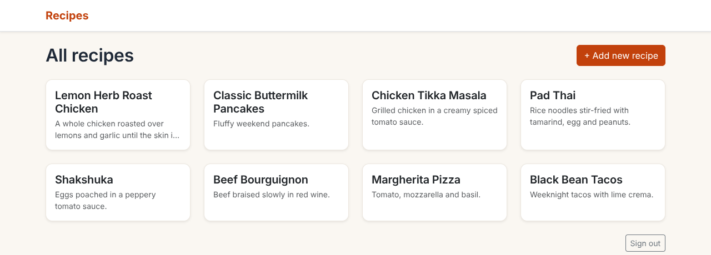
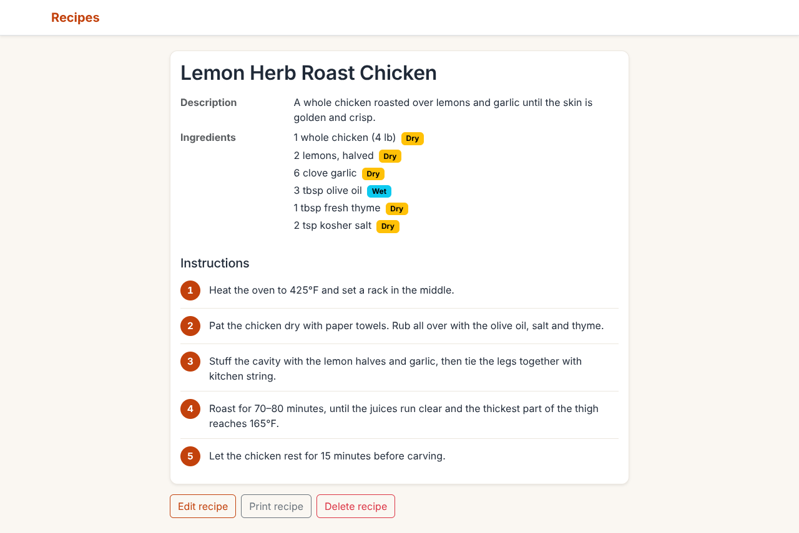
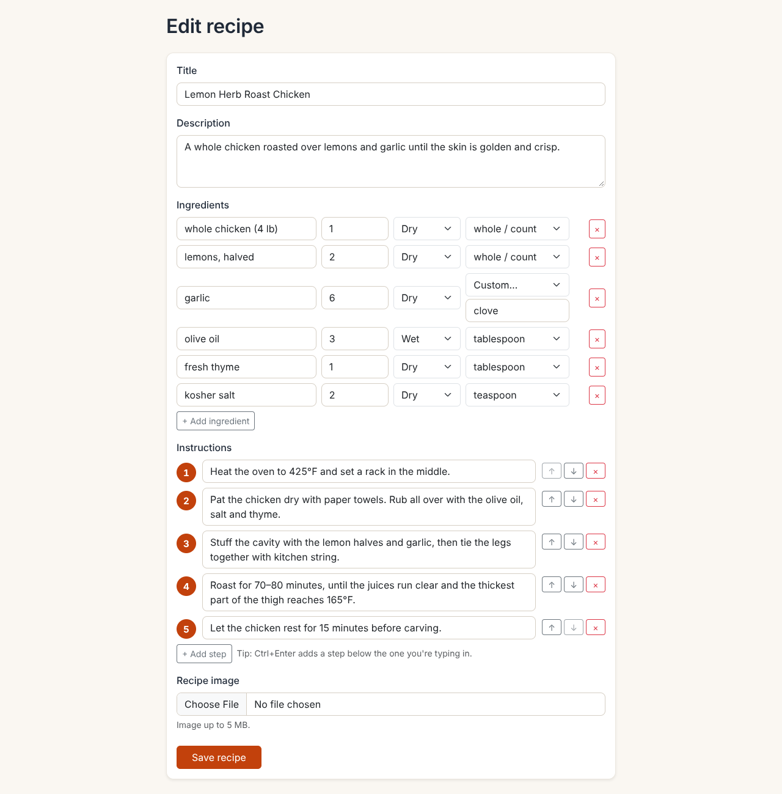
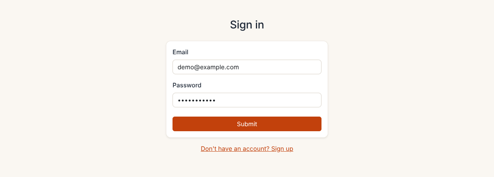

# Supabase and Next.js Recipe Demo App

A recipe manager built with Next.js and Supabase. Each person signs up, signs in and keeps their own private collection of recipes, with photos, structured ingredients and numbered instructions.

## Features

**Accounts**
- Sign up and sign in with email and password ([Supabase Auth](https://supabase.com/docs/guides/auth)).
- Clear error messages on the sign-in page, such as "Invalid login credentials".
- Every recipe belongs to the person who created it. Postgres row level security means nobody else can see, change or delete it.

**Recipes**
- All your recipes shown as cards with a photo, title and the start of the description. Click a card to open the recipe.
- Create, edit and delete recipes, each with a title, description and photo.
- **Photos** are stored in [Supabase Storage](https://supabase.com/docs/guides/storage). Only image files up to 5 MB are accepted. Each upload gets a unique name, and the old photo is removed when it is replaced or its recipe is deleted.
- **Print** a recipe from its page. Buttons and navigation are left out of the printout, and step numbers print cleanly in black and white.

**Ingredients**
- Each ingredient has a name, an amount, a type (dry or wet) and a unit.
- The unit list depends on the type: dry units (cup, tablespoon, teaspoon, grams, ounces, pounds, pinch) or wet units (cup, tablespoon, teaspoon, milliliters, liters, fluid ounces).
- "Whole / count" for items like "2 eggs", and **custom units** such as "clove", "can" or "handful".
- New rows start as a dry cup, the most common measurement.
- The recipe page labels each ingredient with a Dry or Wet badge.

**Numbered instructions**
- Instructions are entered one step at a time. Each step has its own numbered box, which grows to fit the text.
- Move steps up or down, remove them, or add a new one with "+ Add step". Ctrl+Enter (Cmd+Enter on a Mac) adds a step below the one you are typing in.
- The recipe page shows each step next to a numbered circle.
- Recipes saved before steps existed are split into steps automatically when shown or edited, using their "1.", "2)" or "Step 3:" numbers, or one step per line.

**Running it**
- Builds and runs on Node.js 26.
- Optional Docker setup with a one-command deploy script, health check and automatic restart (see [Run it in Docker](#6-run-it-in-docker-optional)).

## Screenshots

All recipes, as cards you click to open:



A recipe, with ingredients marked dry or wet, numbered instruction steps, and buttons to edit, print or delete it:



Adding or editing a recipe. Each ingredient has an amount, a dry/wet type and a unit, including custom units such as "clove". Instructions are entered one numbered step at a time:



Sign in:



## Technologies used

- Frontend:
  - [Next.js](https://github.com/vercel/next.js) 12, a React framework. Pages that show your recipes are rendered on the server.
  - [supabase-js](https://supabase.com/docs/reference/javascript) v2 for sign-in, the database and file storage.
  - [Bootstrap](https://getbootstrap.com) 5 for layout and styling.
- Backend:
  - [Supabase](https://supabase.com): hosted Postgres database, authentication and storage.
- Runtime: Node.js 26, run directly or in Docker.

## Build from scratch

### 1. Create a Supabase project

Sign up at [supabase.com](https://supabase.com) and create a new project. Wait for your database to start.

### 2. Get the URL and key

Open Project Settings, then the API tab, and copy your Project URL and `anon` key. You'll need them in the next step.

The `anon` key is your client-side API key. It allows "anonymous access" to your database until the user has logged in. After that, requests use the user's own login token, which is what makes row level security work. Read more [below](#postgres-row-level-security).

**_NOTE_**: The `service_role` key has full access to your data and bypasses every security policy. Keep it secret, use it only in server environments, and never put it in this app's settings.

### 3. Environment variables

Create a file called `.env.local` in this folder:

```
NEXT_PUBLIC_SUPABASE_URL=
NEXT_PUBLIC_SUPABASE_ANON_KEY=
```

Fill in your URL and key. (For Docker, the same two values go in `.env` instead; see step 6.)

### 4. Set up the database

Run the SQL files in `sql/` in the Supabase SQL editor, in this order:

1. `sql/recipes.sql` (creates the `recipes` table)
2. `sql/add_user_id_column.sql`
3. `sql/add_file_path.sql`
4. `sql/add_description_column.sql`
5. `sql/enable_rls.sql`
6. `sql/create_rls_policies.sql` (recipe policies, shown below)
7. `sql/create_recipe_images_storage_bucket.sql` (photo bucket and storage policies, shown below)

The `recipes` table:

```
CREATE TABLE recipes (
  id bigint GENERATED BY DEFAULT AS IDENTITY PRIMARY KEY,
  created_at timestamp with time zone DEFAULT timezone('utc'::text, now()) NOT NULL,
  updated_at timestamp with time zone DEFAULT timezone('utc'::text, now()) NOT NULL,
  title text,
  ingredients text,
  instructions text,
  region text
);
```

The later files add `user_id`, `file_path` (the photo's path in storage) and `description` columns. The `region` column is no longer used by the app; it is kept so existing databases keep working, and can be dropped with `alter table recipes drop column region;` if you like.

Ingredients and instructions are stored as JSON in their text columns, so no extra tables are needed:

- `ingredients`: a list of `{ "name", "amount", "unit", "type" }` objects, e.g. `[{"name":"garlic","amount":"6","unit":"clove","type":"dry"}]`
- `instructions`: a list of step strings, e.g. `["Heat the oven to 425°F.", "Roast for 70 minutes."]`

Older recipes with plain-text ingredients or instructions still display and edit correctly. They are saved in the new format the next time they are edited.

Recipe policies (`sql/create_rls_policies.sql`):

```
create policy "Recipes can only viewed by owner"
  on recipes for select
  using ( user_id = auth.uid() );

create policy "Owner can create their own recipes"
  on recipes for insert
  with check ( auth.uid() = user_id );

create policy "Owner can delete their own recipes"
  on recipes for delete
  using ( auth.uid() = user_id );

create policy "Owner can update their own recipes"
  on recipes for update
  using ( auth.uid() = user_id );
```

Storage bucket and policies (`sql/create_recipe_images_storage_bucket.sql`):

```
insert into storage.buckets (id, name)
values ('recipe_images', 'recipe_images');

-- Create bucket policies
-- Policy that allows any authenticated user to view all recipe images
create policy "Any authenticated user can view recipe images"
  on storage.objects for select
  to authenticated
  using ( bucket_id = 'recipe_images' );

-- Policy that allows the user that creates a recipe to upload an image for the recipe
create policy "User can upload their own recipe image"
  on storage.objects for insert
  with check ( 
    bucket_id = 'recipe_images'
    and auth.uid() = owner
  );

-- Policy that allows the user that first uploaded an image (owner) to update the image
create policy "User can update their own recipe image"
  on storage.objects for update
  using (
    bucket_id = 'recipe_images'
    and auth.uid() = owner
  );
-- Policy that allows the user that first uploaded an image (owner) to delete it,
-- so the app can remove old images when a recipe's image is replaced or the recipe is deleted
create policy "User can delete their own recipe image"
  on storage.objects for delete
  using (
    bucket_id = 'recipe_images'
    and auth.uid() = owner
  );
```

### 5. Run the application

This project builds and runs on Node.js 26 (pinned in `.nvmrc`, `.node-version` and `engines` in `package.json`). With nvm, run `nvm use` in this folder first.

```
npm install
npm run dev
```

Open `http://localhost:3000/` in your browser and you're ready to go 🚀.

For a production build, run `npm run build` and then `npm start`.

### 6. Run it in Docker (optional)

The repo includes a `Dockerfile`, `docker-compose.yml` and a `deploy.sh` script that builds the app on Node.js 26 and keeps it running in a container.

```
git clone https://github.com/harmonyideas/recipe-demo.git
cd recipe-demo
cp .env.example .env      # then put your Supabase URL and anon key in .env
./deploy.sh
```

`deploy.sh` pulls the latest code, rebuilds the image, restarts the container and waits until it is healthy. Run it again whenever you want to update. Use `./deploy.sh --no-pull` to rebuild without pulling.

- The container restarts automatically after a crash or a reboot (`restart: unless-stopped`).
- By default the app listens on `127.0.0.1:3000` on the Docker host, so it is reachable only from that machine or through an SSH tunnel. Set `APP_BIND=0.0.0.0` and/or `APP_PORT` in `.env` to change that.
- The Supabase values are compiled into the app when the image is built, so rebuild (`./deploy.sh`) after changing them.
- The container runs as a non-root user with only production dependencies installed.
- Useful commands: `docker compose logs -f` (live logs), `docker compose ps` (status), `docker compose down` (stop and remove).

## How it works

### Postgres row level security

Supabase creates an `auth` schema in your database, with helper functions such as `auth.uid()`. When a user signs in, they get a JWT with the role `authenticated` and their user ID. The policies above use that ID so each person can read and change only their own recipes.

### Sign-in and server-rendered pages

The recipe pages are rendered on the server, so the server needs to know who is signed in. After sign-in, the browser sends the session to `pages/api/auth.js`, which stores the access token in an `sb:token` cookie. The server reads that cookie to fetch the user's recipes as that user, so row level security still applies.

- The sign-in page waits for that cookie to be stored before opening your recipes. Sign-out clears it before returning to the sign-in page.
- The cookie is `HttpOnly` and `SameSite=Lax`. It is also marked `Secure` when the app is served over HTTPS, including behind a proxy that sets `X-Forwarded-Proto: https`.

## Notes and limitations

- Over plain HTTP, the login cookie is not encrypted in transit. Use HTTPS for anything beyond local or tunneled use.
- `pages/api/auth.js` rejects requests (403) whose `Origin` header does not match the `Host` header. Together with `SameSite=Lax` this is a partial CSRF mitigation, not full protection, which would also need per-request CSRF tokens.
- The storage policy lets any signed-in user view any image in the `recipe_images` bucket if they know its path. Recipe data itself is private to its owner.
- There is no "forgot password" page yet. Passwords can be reset from the Supabase dashboard under Authentication → Users.

## Project structure

```
pages/              Next.js pages
  signin.js, signup.js
  index.js            all recipes (cards)
  recipes/new.js      create a recipe
  recipes/[id]/       view and edit a recipe
  api/auth.js         stores and clears the sign-in cookie
components/         form, ingredient list, step editor and display components
utils/              Supabase server client, ingredient and step helpers, auth cookie helper
styles/globals.css  app styles, including numbered steps and print styles
sql/                database and storage setup scripts
docs/screenshots/   README screenshots
Dockerfile, docker-compose.yml, deploy.sh, .env.example   Docker setup
```

## Authors

- [Supabase](https://supabase.com), original example
- [Harmony Ideas](https://github.com/harmonyideas)

Supabase is open source - get involved at https://github.com/supabase/supabase
